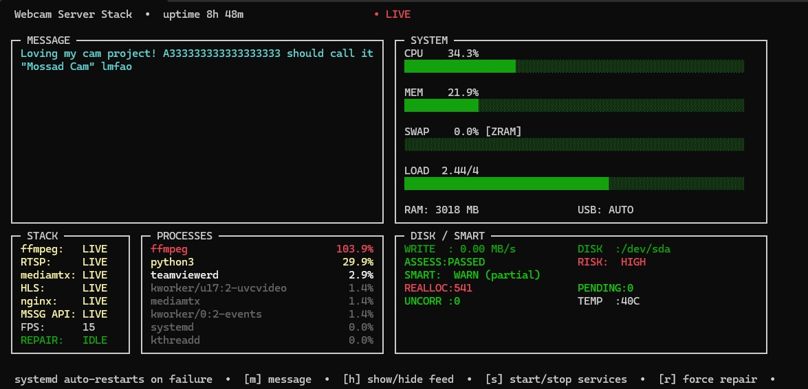
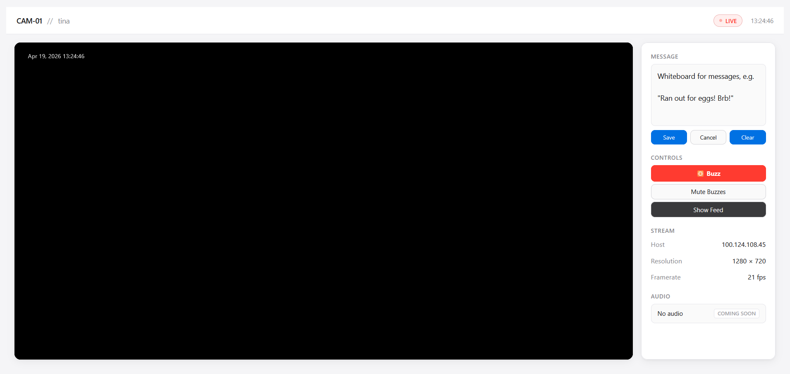

# laptop-livecam

Turns an old laptop or a USB webcam into a live camera appliance — HLS video, two-way audio, computer-vision presence detection, and a browser-based family presence system — message board, dark mode cloak, buzz notifications, and a terminal monitor.



---

## Part of the `laptop-comms` suite

laptop-livecam is one of two packages that are built to run together on the
same machine:

| package | what it is |
|---|---|
| **laptop-livecam** | this one — the camera appliance |
| **[ele-messenger](https://github.com/thefangeddeity/ele-messenger)** | a household messenger that keeps working when the internet does not |

Either one installs and runs perfectly well alone. Installed together on the
same node they share one origin and one set of names, so there is nothing to
configure to make them cooperate:

| path | what answers |
|---|---|
| `/` | a home page naming the node, with a door to each app |
| `/llc` | the camera viewer |
| `/elem` | the messenger |

Because they share an origin, the viewer's **Messages card** reads and sends
through the messenger directly, and the two pages share a theme and a single
light/dark switch. Where no messenger is installed the card does not appear
and `/elem` answers 404 — the name exists across the fleet whether or not the
service does, which is the honest degradation rather than a broken link.

---

## What it does

- **Streams** a USB webcam via HLS (H.264, MediaMTX + ffmpeg) to any browser — Chrome, Firefox, Safari, mobile
- **Web viewer** with live status indicator, uptime counter, freeze-frame on signal loss, and fullscreen
- **Message board** — type a message from `camdash` or the sidebar; it persists until cleared
- **Dark mode** — cloaks the feed with a black overlay; the stream keeps running underneath
- **Buzz** — MSN-style screen shake + sawtooth tone, triggered from the viewer sidebar or API
- **`camdash`** — SSH-friendly curses TUI showing full pipeline health (ffmpeg → RTSP → mediamtx → HLS → nginx → API), system resources, SMART disk status, and service controls
- **`camdash-gui`** — the same operator picture in a PySide6/Qt window, for when you're at the machine instead of SSH'd in
- **Auto-repair** — detects stream down for 8s and triggers repair automatically



---

## Architecture

```
v4l2 device → ffmpeg → RTSP (:8554) → mediamtx → HLS (:8888) → nginx (:80) → browser
                                                                      ↑
                                                              broadcast-api (:5000)
```

- **ffmpeg-cam.service** captures from the stable `/dev/v4l/by-id/...` path, pushes RTSP to MediaMTX
- **mediamtx** serves HLS on `:8888`
- **nginx** proxies on `:80`, serves the web viewer, and routes `/api/broadcast`, `/api/dark`, and `/api/buzz` to the Flask broadcast API
- **broadcast-api** Flask service runs as `www-data` on `127.0.0.1:5000`
- **Dark mode** flag lives at `/var/lib/hls-livecam/dark`; cloak image at `/var/www/hls-livecam/dark.png`
- Device config persisted in `/etc/hls-livecam/device.env`

---

## Requirements

- Debian family (amd64): Ubuntu 20.04+ / Linux Mint 20+ / Debian 11+
- Arch (x86_64), via the AUR package
- USB webcam with MJPEG support
- Internet access during setup (downloads the MediaMTX binary)

---

## Installation

The package is `laptop-livecam`. Build the .deb from a committed tree with
`scripts/deploy_tina.sh`, which names it `laptop-livecam_<version>_amd64.deb`.

### Debian / Ubuntu / Mint

```bash
sudo apt update

# Install the package. Use `apt install ./<file>`, not `dpkg -i`: apt reads
# the Depends field and pulls ffmpeg, nginx, v4l-utils, python3-psutil,
# python3-flask, python3-pil, python3-numpy, python3-opencv, wget and
# ca-certificates for you. `dpkg -i` would leave them unresolved.
sudo apt install ./laptop-livecam_*_amd64.deb

# Run the setup wizard
sudo hls-livecam-setup
```

pyfakewebcam is not packaged by Debian or Ubuntu, so the .deb ships a
vendored copy under `/usr/share/hls-livecam-server/vendor`. Nothing is
installed from the network at package-install time.

### Arch

```bash
# From the AUR packaging repo (aur-laptop-livecam)
makepkg -si

sudo hls-livecam-setup
```

Arch gets pyfakewebcam from the `python-pyfakewebcam` dependency the
PKGBUILD declares, and ignores the vendored copy.

The setup wizard auto-detects your webcam, downloads MediaMTX, writes all config, and starts all services.

---

## After setup

| What | Where |
|------|-------|
| Web viewer | `http://<your-ip>` |
| HLS stream | `http://<your-ip>:8888/cam/index.m3u8` |
| RTSP (VLC) | `rtsp://<your-ip>:8554/cam` |
| Terminal monitor | `camdash` |
| GUI dashboard | `camdash-gui` |

---

## Commands

| Command | What it does |
|---------|-------------|
| `camdash` | Launch the TUI monitor (SSH-friendly) |
| `camdash-gui` | Launch the windowed operator dashboard |
| `sudo hls-livecam-setup` | Reconfigure / change webcam or framerate |
| `sudo hls-livecam-repair` | Fix a broken stream |
| `sudo hls-livecam-dark` | Toggle dark mode cloak |

### camdash keys

| Key | Action |
|-----|--------|
| `m` | Send broadcast message |
| `h` | Show / hide feed (dark mode) |
| `s` | Start / stop services |
| `r` | Force repair |
| `q` | Quit |

---

## Broadcast API

The Flask API runs locally and is proxied by nginx:

```bash
# Send a message (appears in the viewer sidebar and as a pill overlay)
curl -X POST http://localhost/api/broadcast \
  -d '{"message":"Ran out of eggs! Brb!"}' \
  -H 'Content-Type: application/json'

# Toggle dark mode
curl -X POST http://localhost/api/dark

# Trigger buzz (screen shake + sawtooth tone on all viewers)
curl -X POST http://localhost/api/buzz
```

---

## PENDING.md

[`PENDING.md`](PENDING.md) is the running handover: what is in git but not in
any tag, `.deb` or AUR package, what other branches should check their own
code for, and the measurements behind each. **Every node clones it from
here** — it used to be copied around by hand, which meant the copies drifted.
Read it before assuming an install matches this tree.

---

## The viewer

The sidebar is an instrument panel, ported from the macOS branch's design
rather than reinterpreted. Three materials, kept strictly apart:

- **engraved** — every label. One gray, one carved shadow, cast into the
  housing. It cannot light up, gray out or turn green, so the eye tracks
  lamps instead of re-reading words.
- **lamps** — all state. **Only what is actually measured lights up.** On
  this branch MediaMTX and RTSP have no probe, so they stay dark rather than
  green; a lamp that can never fail is indistinguishable from a broken one.
- **phosphor** — live values, behind glass, over ghost segments. An unknown
  reading shows the ghosts alone — never a zero, never a guess.

Nothing outside the glass is ever phosphor-coloured, nothing inside it is
ever gray, and **the tube does not invert in light theme**. A vacuum tube has
no light mode: the housing goes pale, the glass stays a dark screen set into
it.

Panels run **VIDEO · AUDIO · MESSAGE**, each reading status then controls.
The two media boxes share one geometry — a small key on the left, its control
hard right — so learning one teaches the other.

`Show / CV / Hide` set the published feed for everyone. The LISTEN transport
and the `MUTE` key are **local to your browser**: the transport starts and
stops the room audio without touching the picture, and MUTE silences it here
without telling the server or stopping the stream.

The picture uses `object-fit: contain`. It letterboxes rather than cropping,
because the CV pipeline burns telemetry into the frame and `cover` was
cutting it off at the bottom on any window shorter than 16:9.

---

## Feed modes

Three modes, set from the viewer, `camdash-gui` or `camdash`, and persisted
across restarts in `/var/lib/hls-livecam/feed_mode`.

**Privacy fails closed.** If the persisted feed-mode file is missing,
unreadable, invalid, or otherwise cannot be trusted, the node falls back to
**`hide`** — never `show` and never `cv`. A camera pointed at a private space
must not become visible merely because its privacy state cannot be read.

| mode | what is published |
|---|---|
| `show` | the camera |
| `cv` | the camera, processed (see CV Mode) |
| `hide` | privacy/static output, plus silence |

`cloak` is accepted as a permanent alias for `cv` on `/api/feed-mode`. Not a
transition window — every node in the fleet talks to every other node's
endpoints and no two ship on the same day.

### Hide publishes static, not black

Rendered server-side, so the web viewer, the Qt dashboard, camdash and anyone
opening the HLS URL directly all get it — no per-surface wiring, and no
surface can miss the memo and show something else. It is derived from nothing:
no camera frame touches that path.

**Static is not expensive, and the widely-repeated claim that it is comes from
an unconstrained encoder.** Measured on a reference node, at the publisher's real
settings:

| | render | published |
|---|---|---|
| black | ~0 ms (cached array) | 40 kb/s |
| static | +3.6 ms/frame | **1560 kb/s** |
| the live feed, for scale | — | ~1500 kb/s (`-b:v 1500k`) |

So static costs **the same as the live feed**, not more, because `-b:v` is
doing rate control. Encode a noise clip with no bitrate cap and you will
measure 1.6–1.8 Mb/s and conclude static is costly; put the cap back and the
difference disappears. Two things make it cheap: the `-b:v` ceiling, and
generating the noise small (224×126) and scaling up **nearest-neighbour**, so
the encoder sees large flat blocks rather than per-pixel noise.

The viewer keeps a "camera is switched off" notice on top of the snow. Static
on its own is exactly what a dead feed looks like — that notice is the only
thing separating deliberate from broken.

### Room audio

Off by default. Set `AUDIO_ENABLED=1` in `/etc/hls-livecam/device.env` along
with `AUDIO_DEVICE` (default `hw:0,0`), and the publisher gains a second input
and publishes AAC alongside the video as an `EXT-X-MEDIA` rendition.

The service user must be in the `audio` group — `/dev/snd/*` is `root:audio`,
and the setup wizard adds it. Without it ffmpeg fails with `Cannot get card
index` and only the log says why.

**Hide closes the microphone.** Hidden swaps the ALSA input for `anullsrc`, so
the device is never opened — not muted, closed. `GET /api/audio` reports
`disabled` (no mic configured), `off` (configured but closed because hidden)
or `ok`, and reports the rate and bitrate this node actually gave ffmpeg,
never the manifest's `BANDWIDTH` (which is video+audio combined and overstates
audio badly).

**Stage the input before trusting it.** Both fleet nodes shipped with mics
that looked broken and were not — one with +60 dB of stacked gain railing the
input, one muted at 0. `mean_volume` alone will not tell you which you have;
**flat factor and DC offset** will. A railed input reads flat factor ~88 and
DC ~0.34, real audio reads flat factor 0.000 and DC ~0. Persist with
`alsactl store` once it is right.

---

## Troubleshooting

| Problem | Fix |
|---------|-----|
| Stream broken | `sudo hls-livecam-repair` |
| Service status | `sudo systemctl status mediamtx ffmpeg-cam` |
| Full logs | `sudo journalctl -u ffmpeg-cam -n 40 --no-pager` |
| Webcam busy | `sudo fuser -k /dev/video0` |
| List webcams | `v4l2-ctl --list-devices` |

---

## SMART note

If `camdash` reports `REALLOC > 500` in the DISK/SMART panel, your drive has significant sector reallocation. Back up your data. The stream will continue running but the drive should be replaced soon.

---

## Editing the visible area when masking is on

The mask is applied **server-side, at the camera**, before anything is
encoded -- which is what makes it a privacy control rather than a costume:
the stream, the recording, the clips and the detector all receive the same
already-masked frame, so none of them can disagree with the switch.

It also means you cannot see what you are about to include. Everything
outside the area is genuinely not in the picture that reaches your browser,
so dragging a new region while the mask is on is guessing at geometry you
have no way to see.

**To re-draw the area, switch "Hide the rest" off first**, set the new
region, then switch it back on.

The exception is **"Pixelate instead"**: a mosaic still carries enough
structure to aim by, so you can re-draw without turning the mask off. That
is also the trade -- a mosaic is weaker than black, because what lets you
aim is the same coarse structure it leaves behind.

## License

GPL-3.0 — see [LICENSE](LICENSE)
